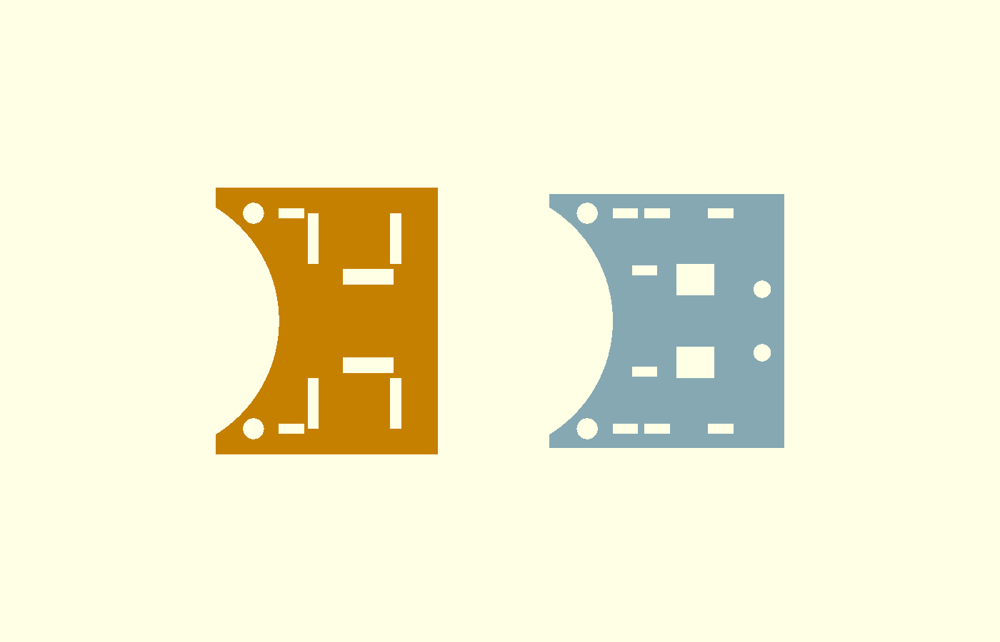

# 발주 R2: 선반 고정부 수정과 31개 수량 (#224)

업체가 표시한 배터리·전자부 선반의 기둥 고정부를 수정했다. 기존 주문은 R2 전체로 교체한다. 두 버전을 합산하지 않는다. 이 문서는 첫 시제품 발주 자료이며 실물 강도 시험 결과가 아니다.

[발주 ZIP 다운로드](../../print-orders/20261021-R2/COSMOS_ORDER_R2_31pcs.zip). SHA256: `2cd1151eeb466d47fe09293242f1e27d9ac019838ae97595b5f30469d5f72890`.

## 수정

- 기둥 중심 반경 48 mm와 보어 Ø6.6 mm를 유지했다.
- 새들 링은 명목 벽 2.4 mm, 높이 16 mm의 닫힌 둘레다. 원호에 잘리던 끝을 없앴다. 이는 강도 계산으로 정한 허용 하중이 아니라 제작을 위한 형상 선택이다.
- 새들 바깥면과 중앙 흡기 파임 사이 설계 여유는 0.3 mm다. 중앙 파임 반경 42 mm를 유지했다.
- 안쪽 타이 슬롯을 제거하고 바깥 슬롯 중심을 기둥 중심에서 7 mm 대신 12 mm로 옮겼다. 슬롯과 새들 바깥면 사이 여유는 2.3 mm다.
- 고정부의 가늘고 뾰족한 끝을 남기던 절삭 조합을 제거했다. 단순히 선반 전체를 두껍게 만들지 않았다.
- 타이는 바깥 슬롯과 선반 가장자리를 통해 고정부를 감싼다. 업체에는 새들·뿌리의 국부 인필 100%를 요청한다.

벽 두께와 노즐 폭을 함께 고려해야 한다는 근거는 [Prusa 설계 안내](https://help.prusa3d.com/article/modeling-with-3d-printing-in-mind_164135)다. 이 안내는 기체 하중에 대한 강도 인증을 제공하지 않는다.

## 수량

| 종류 | 본체용 | 예비·다른 끼움 규격 | 발주 |
|---|---:|---:|---:|
| 베인링 | 1 | 0 | 1 |
| 상판 | 1 | 0 | 1 |
| EDF 클램프 반쪽 | 2 | 0 | 2 |
| 배터리 선반 | 1 | 0 | 1 |
| 전자부 선반 | 1 | 0 | 1 |
| ESC 브래킷 | 1 | 0 | 1 |
| 베인 | 4 | 4 | 8 |
| 기본 커플러 | 4 | 4 | 8 |
| 여유 0.4 mm 커플러 | 0 | 4 | 4 |
| 발 범퍼 | 4 | 0 | 4 |
| 합계 | 19 | 12 | 31 |

업체의 사진만으로 겹친 물체나 모든 반복 묶음의 개수를 확정할 수 없다. R2는 기존 10개 묶음 STL을 연결 조각별로 분리해 파일 31개로 제공한다. 파일마다 물리 부품 하나만 들어 있다. 각 파일을 한 번씩 출력한다. 추가 복제하지 않는다.

## 검사와 한계

- OpenSCAD 2021.01로 마스터 STL 10종을 재생성했다. 검증 echo 22줄, 경고 0건, 모든 마스터의 열린 모서리 0개다.
- 연결 조각 수: 단일 부품 5파일, EDF 클램프 2조각, 베인·기본 커플러·여유 커플러·발 범퍼 각 4조각이다. 총 마스터는 10개다.
- 패키지의 STL 31개 모두 연결 조각 1개, 열린 모서리 0개다. 전체 삼각형 25,020개의 단위 법선도 0이 아니다. 파일별 해시·부피·크기는 [order-manifest.json](order-manifest.json)에 있다.
- 두 선반만 형상이 바뀌었다. 나머지 8종은 `bac73f3`에서 생성한 STL과 삼각형 좌표를 정렬해 비교했고 동일했다. 베인링에는 이전 체결면 수정이 포함돼 있다.
- 두 선반의 완전한 새들 둘레와 이전 안쪽 슬롯 자리의 재료를 OpenSCAD 차집합으로 검사했다. 수치적 공면 잔여물을 피하기 위해 검사 부피만 0.05 mm 안쪽으로 줄였다. 허용 응력이나 피로 강도를 검사한 것은 아니다.
- `python -m unittest -q test_cadcheck test_interference`: 49개 통과.
- 두 선반을 포함하는 49쌍 중 경계 상자가 겹친 4쌍을 정밀 검사했다. 기둥·만능기판 쌍 3건은 교집합이 비었고 배터리 바닥 1건은 두께 없는 면 접촉이었다. 허용값 0.001 cm3를 넘는 부피 간섭은 없었다. 검사한 26개 부품·상태의 삼각형 좌표를 10/20 검사본과 대조했으며 두 선반만 달랐다. 나머지 쌍에는 이전 검증을 적용한다.
- PrusaSlicer 2.9.6의 기존 참고 프로파일에서 배터리 선반 21.25 g, 전자부 선반 21.89 g을 계산했다. 업체의 방향·국부 인필·서포트가 달라지므로 실제 질량은 다를 수 있다.
- 10/20 전체 기체 CG 보고는 이전 선반과 EVA 발 범퍼를 가정했다. 이번 발주는 PETG 발 범퍼이므로 그 CG를 발주본의 확정값으로 쓰지 않는다. 실제 질량·체결·조립 CG는 #219에서 확인한다.



## 재생성

두 출력 폴더는 별개여야 한다. 패키지 폴더는 새 폴더를 지정한다.

```powershell
python cad/tools/export_print_parts.py --out <masters>
python cad/tools/package_print_order.py --masters <masters> --out <새 패키지 폴더> `
  --archive <새 ZIP> --manifest-copy <새 manifest>
```

새 ZIP과 manifest를 기준 파일과 대조한 뒤 기준 파일을 교체한다. 재생성 명령으로 기준 파일을 바로 덮어쓰지 않는다. ZIP은 재현 가능한 해시를 위해 압축하지 않고 고정 메타데이터로 저장한다.

ZIP에는 `PRINT_ONCE_31_FILES/`, 중국어·한국어 발주서, 해시 목록만 넣는다. 원본 묶음 STL과 G-code는 넣지 않는다. 업체는 구버전 배치를 지우고 R2 31개를 각각 한 번씩 배치한다. 배율 100%, 단위 mm, PETG, 노즐 0.4 mm, 레이어 0.2 mm, 외벽 4줄, 상하면 각 6층, gyroid 인필 40%가 기본 요청이다. 출력 방향과 서포트는 업체가 장비에 맞춰 결정한다.
