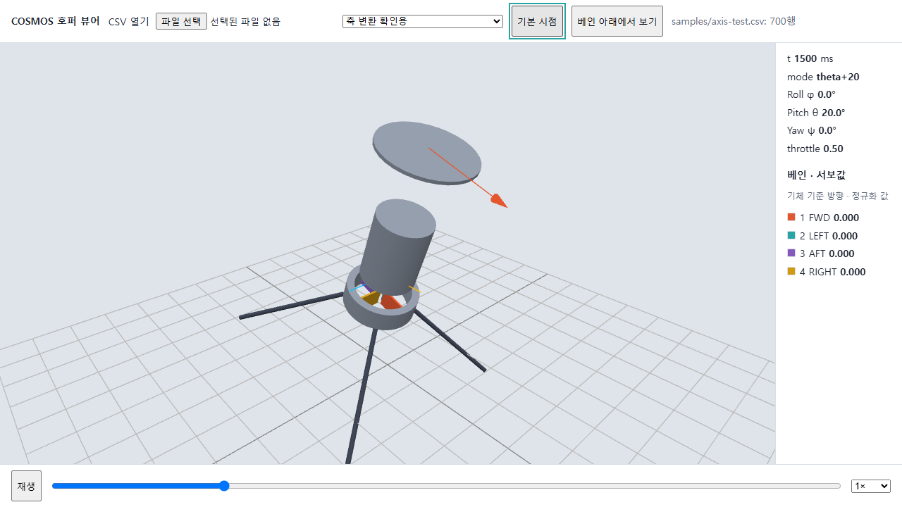
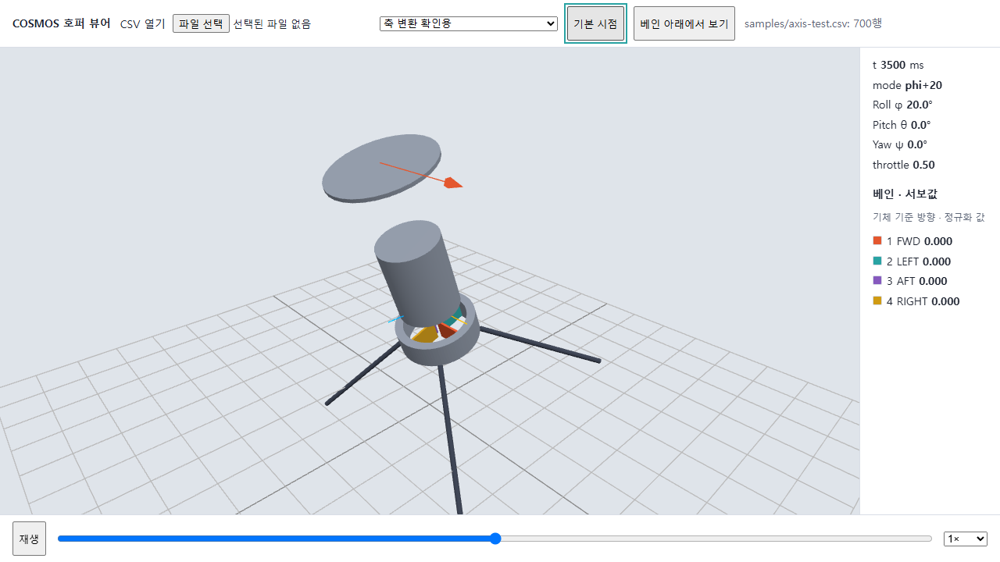
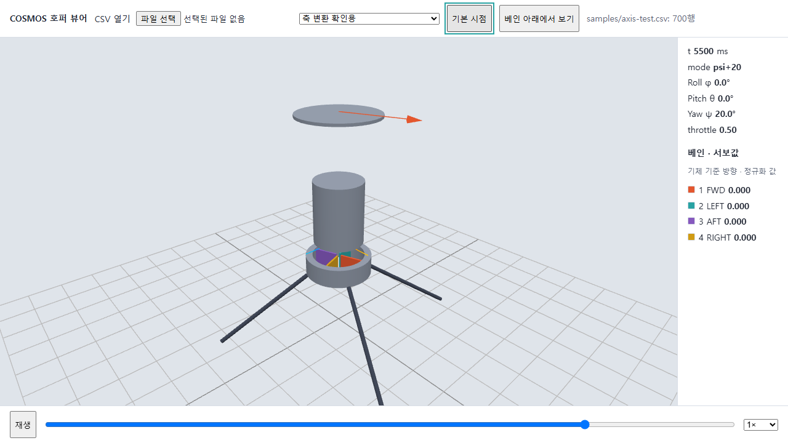
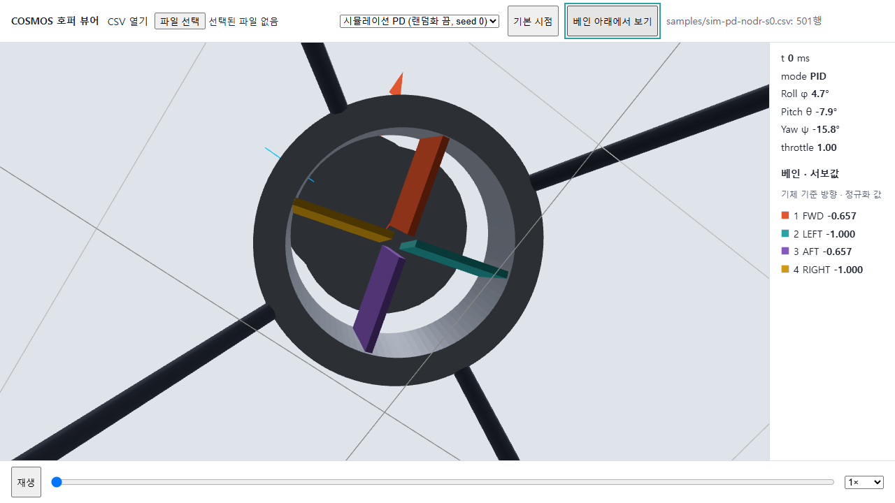
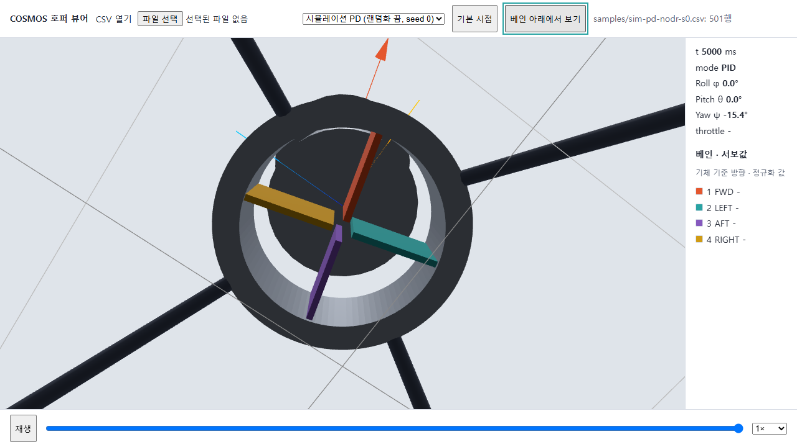

# 웹 축·베인 화면 확인 (#93, #95)

2026-10-19, Windows Chromium, 1280×720. 구현 커밋 fe6900b. 자동 브라우저로 예제 CSV를 재생하고 화면을 확인했다. 실물 센서·서보 시험이 아니다.

| 그림 | CSV | t_ms | 시점 | 확인한 것 |
|---|---|---:|---|---|
| axis-theta20 | axis-test.csv | 1500 | 기본 | Pitch +20°, FWD 아래 방향 |
| axis-phi20 | axis-test.csv | 3500 | 기본 | Roll +20° |
| axis-psi20 | axis-test.csv | 5500 | 기본 | Yaw +20° |
| vanes-deflected | sim-pd-nodr-s0.csv | 0 | 아래 | servo −0.657, −1, −0.657, −1, 네 색과 범례 |
| vanes-neutral | sim-pd-nodr-s0.csv | 5000 | 아래 | 마지막 행 servo 공란: 뷰어가 중립 처리. 측정된 0 명령이라는 뜻은 아님 |

축 방향 수치는 `npm run check`의 쿼터니언·오일러 대조와 함께 확인했다. 아래 시점 버튼은 기체 자세나 시각을 바꾸지 않는다. 개발 서버 콘솔의 favicon.ico 404 한 건은 기존 상태이며 앱 실행 오류는 없었다.

## 재현

`cd web`에서 `npm ci`, `npm run dev`를 실행한다. 예제를 선택하고 시간 슬라이더를 표의 시각으로 옮긴다. 베인은 `베인 아래에서 보기`를 누른다.

