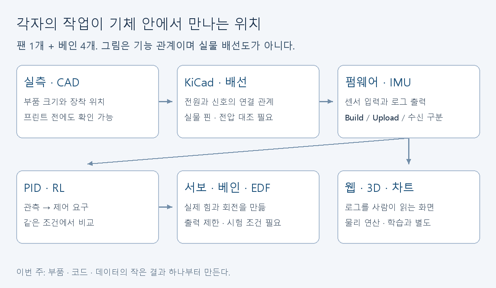

# 처음 참여하는 부원을 위한 COSMOS 학습 안내

우리 프로젝트를 처음 듣고도 자기 과제를 시작할 수 있도록 만든 자료다. **64개 외부 자료 중 영상·영상 강좌 항목이 33개**다. 한국어 설명, 프로젝트 그림, 실행 가능한 작은 예제도 함께 있다. 전부 먼저 읽을 필요는 없다. 아래에서 자기 담당의 첫 실습부터 시작한다.

현재 조건: 3D프린트 외주 미발주, USB 데이터 케이블 주문 완료, Teensy 실물 업로드 성공 미확인. 이 조건을 반영한 [2주차 활동 진행표](week-02.md)를 사용한다. 예전 실행계획의 프레임 조립 과제는 프린트 도착 후로 미룬다. 이 안내의 확인 기준일은 2026-10-14이며 기술 설계 정본을 대체하지 않는다.

## 처음 20분

1. [프로젝트·용어 설명](concepts.md)을 읽는다. 부장·차장이 실제 부품과 CAD를 함께 보여준다.
2. [그림 모음](visuals.md)에서 자기 담당 부품·코드가 어디에 있는지 찾는다.
3. 아래 담당 안내서에서 **첫 30분**만 따라 한다. 자료 ID는 [자료실](resources.md)의 같은 ID를 가리킨다.
4. 화면·표·로그 하나를 만들고 [결과 기록 양식](submission.md)에 적는다.

## 내가 볼 안내서

| 담당 | 첫 과제 | 안내서 |
|---|---|---|
| 시우 | 보드 없이 IMU 스케치를 빌드하고 업로드와 구분 | [전자·펌웨어](tracks/firmware.md) |
| 재후 | 코드의 센서 입력·초기화·출력을 찾고 로그 형식 확인 | [전자·펌웨어](tracks/firmware.md), 이후 [데이터 연결](tracks/web.md) |
| 지훈 | 부품 한 개의 치수·단위·측정 방향 기록 | [실측·CAD](tracks/cad.md) |
| 민찬 | CAD에서 부품 위치를 보여주고 실측값과 변수 연결 | [실측·CAD](tracks/cad.md), [활동 진행표](week-02.md) |
| 민우 | 기존 KiCad 회로도에서 CS 넷 하나 추적 | [KiCad](tracks/kicad.md) |
| 준원 | 교육용 PD 실행, 기존 환경의 관측·행동 찾기 | [제어·PID](tracks/control.md), [시뮬레이션·RL](tracks/rl.md) |
| 민지 | 로컬 3D 모형을 띄우고 슬라이더·색 변경 | [웹·3D·데이터](tracks/web.md) |

이 배정은 기존 [개인별 과제표](../execution/member-weekly-tasks.md)의 담당 구성을 따른다. 처음부터 모든 팀의 도구를 설치하지 않는다. 담당 변경은 부장·차장과 정한다.

## 자료를 찾는 방법

- **글·영상:** [담당별 자료실 64개](resources.md). 각 항목에 볼 범위, 다음 실습, 우리 기체에 적용할 때의 한계를 적었다.
- **그림:** [한국어 개념도 9개와 실제 프로젝트 도면·CAD 렌더](visuals.md).
- **직접 실행:** [PD 부호 실습, 합성 CSV, 로컬 3D 모형](starter/README.md). 보드나 프린트가 없어도 진행한다.
- **심화:** 제어 안내서의 포화·미분·샘플링, RL 안내서의 평가·Sim-to-Real 과제. Stage 1은 최종 3D 시뮬레이터가 아니다.

영어 영상이 안 열리거나 설명이 어려우면 한국어 개념 설명과 동봉 실습부터 진행한다. KOCW 한국어 강의와 중국어 PlatformIO 영상도 자료실에 있다. 학교·중국 네트워크에서 각 영상이 재생되는지는 확인하지 않았고 모든 영상을 끝까지 시청한 목록도 아니다. 항목별 확인 한계를 자료실에 표시했다.

## 지도하는 사람의 준비

부장·차장은 활동 전에 각 담당의 첫 실습을 한 번 실행한다. 본인 PC에 설치됐다는 사실을 부원 PC의 준비 완료로 취급하지 않는다. 설치가 안 된 사람은 설치와 폴더 열기가 첫 과제다. 두 명씩 같은 화면을 보게 하고 한 명은 조작, 한 명은 결과 기록을 맡긴 뒤 역할을 바꾼다.

“PID 구현해”, “회로도 완성해”처럼 범위가 큰 지시 대신 해당 안내서의 첫 동작과 정상 결과를 함께 보여준다. 설명을 들었는지는 부원이 자기 말로 입력·출력과 결과를 짚는 것으로 확인한다. 첫 과제를 통과하면 안내서의 다음 단계로 넘어간다.

설계 결정은 [마스터 설계](../design/00-hopper-master-design.md), [아비오닉스·핀맵](../design/01-avionics-integration-final.md), [제어 파이프라인](../design/03-control-pipeline-design.md), [웹 데이터 계약](../design/02-web-dashboard-design.md)을 따른다. 입문용 그림·숫자·합성 로그를 실제 배선 확정이나 실물 성능으로 사용하지 않는다.

자료를 추가할 때는 [resources.json](resources.json)의 목록을 수정하고 이 폴더에서 `python render_catalog.py`로 [자료실](resources.md)을 갱신한다. 소개·확인 한계 문단은 유지된다. `python render_catalog.py --check`와 `python check_library.py`로 목록 정합성·내부 링크·예제 데이터를 확인한다. 외부 영상 재생 검사는 이 명령에 포함되지 않는다.
