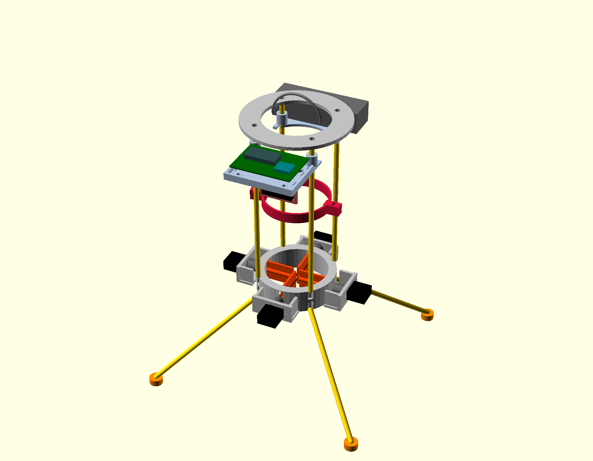
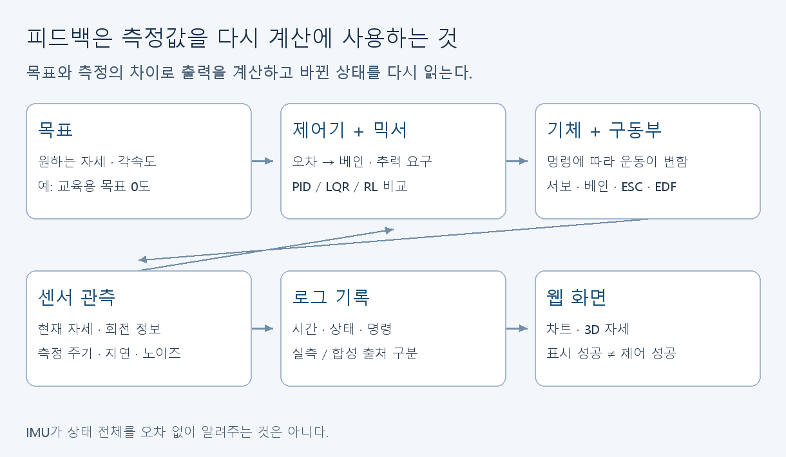
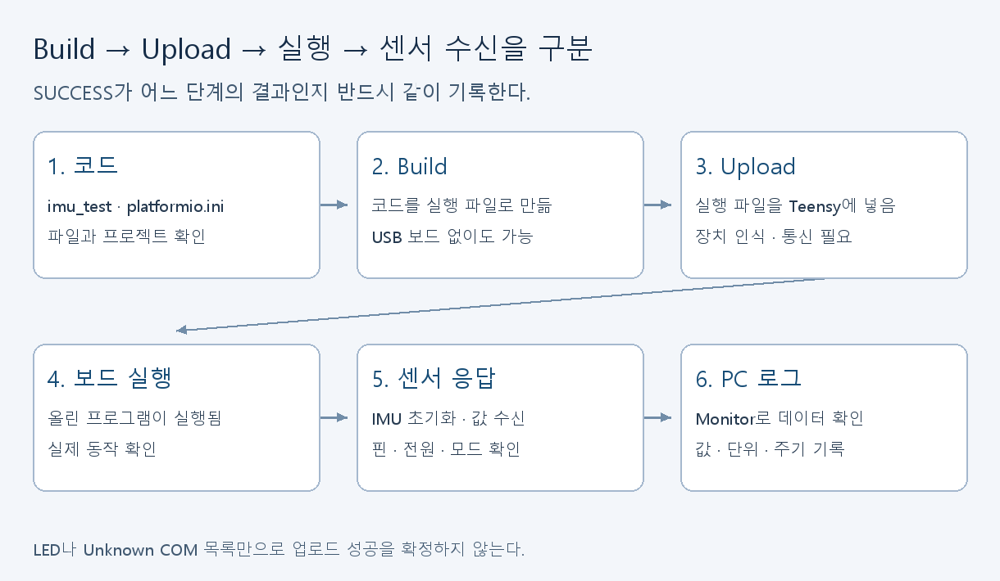
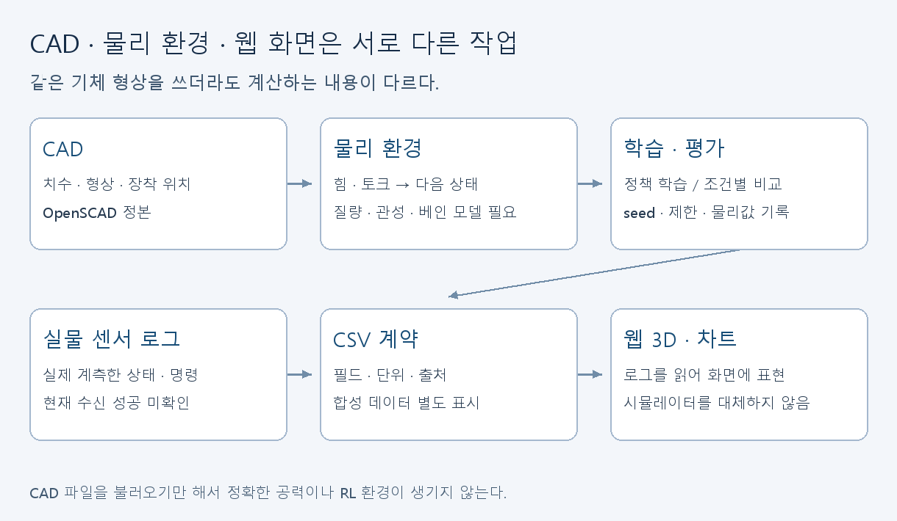

# 우리 프로젝트를 처음 듣는 사람에게

[학습 안내로 돌아가기](README.md)

COSMOS Hopper는 전기 팬 하나로 뜨고 팬 아래 베인 네 개를 움직여 자세를 제어하려는 기체다. EDF는 팬과 덕트가 합쳐진 추진 장치다. ESC는 배터리 전력을 모터에 전달하고 속도를 조절하는 구동 장치다. 서보는 베인의 각도를 바꾸는 작은 모터다. **팬 자체를 두 축으로 기울이는 짐벌 구조와 다르다.** 실제 배치는 아래 CAD 렌더에서 확인한다.

부품 색과 위치를 보여주는 설계 미리보기다. 실물 조립·비행 성공 사진이 아니다. [베인링 확대 렌더](../../cad/renders/vane_ring_closeup.png)와 [CAD 정본](../../cad/hopper_params.scad)을 함께 본다.

## 기체가 기울면 어떤 일이 일어나나

목표는 예를 들어 “똑바로 서 있기”다. IMU라는 센서가 지금 기체의 자세와 회전 정보를 읽는다. Teensy라는 작은 컴퓨터가 목표와 측정을 비교해 제어 출력을 계산한다. 서보가 베인을 움직이고 기체에 작용하는 힘과 회전이 변한다. 센서가 바뀐 자세를 다시 읽는다. 이 반복을 피드백이라고 한다. 센서는 정확도·주기·지연의 영향을 받으므로 센서 숫자를 실제 상태 전체와 동일하게 취급하지 않는다.

| 처음 나오는 말 | 이 프로젝트에서 뜻하는 것 | 확인 질문 |
|---|---|---|
| 목표값 | 우리가 원하는 자세·각속도 등 | 측정값과 어디서 비교하는가? |
| 오차 | 정한 부호 규칙으로 계산한 목표와 측정의 차이 | +10도 기울었으면 오차 부호는? |
| P | 현재 오차에 비례하는 제어 항 | 기울기가 커지면 출력이 어떻게 변하는가? |
| I | 오차를 시간에 따라 누적하는 항 | 출력이 제한돼도 계속 쌓이면? |
| D | 변화에 대응하는 항 | 각도와 회전 속도가 왜 다른가? |
| 믹서 | 회전 요구를 각 베인의 명령으로 분배 | 제어 출력 하나가 어떤 서보에 연결되는가? |
| 포화 | 요구가 장치의 출력 범위를 넘어서 제한됨 | 계산값을 그대로 내보낼 수 있는가? |
| baseline | RL과 같은 조건에서 비교할 기준 제어기 | 현재 구현은 PD인가 PID인가? |
| RL 정책 | 관측을 받아 행동을 선택하는 학습된 함수 | 어디서 학습하고 어디서 실행하는가? |
| 보상 | 시뮬레이션에서 행동 결과를 점수로 나타내는 값 | 점수가 높으면 항상 물리적으로 성공인가? |
| 로그 | 시간과 상태·명령을 남긴 기록 | 실측인지 합성인지 어디에 표시하는가? |

고정 목표 0도인 교육 예제에서 +10도 기울면 오차는 -10도다. 복원 요구를 음수로 정한다. 실제 서보 방향은 장착 방향과 믹서에 따라 달라지므로 이 부호만 보고 서보 핀에 출력하지 않는다. `sim/connectome/baseline_pd.py`는 I 항이 없는 PD다. 최종 cascaded PID를 구현·검증했다는 뜻이 아니다.

## 프로그램 만들기, 넣기, 읽기는 다른 단계다

Build는 코드로 실행 파일을 만드는 단계다. USB 보드가 없어도 성공할 수 있다. Upload는 그 파일을 보드에 넣는 단계다. Monitor는 보드가 보낸 출력을 읽는 단계다. “SUCCESS”가 어느 단계에 나온 것인지 같이 적는다. Arduino IDE에 Unknown COM 포트가 보이거나 LED가 켜진 것만으로 Teensy 업로드 성공을 확정하지 않는다.

현재 `imu_test`는 센서를 읽어 출력하는 브링업용 스케치다. 센서 보고 설정은 50ms, 즉 20Hz다. 실제 수신 간격은 로그로 확인해야 한다. 이 코드의 출력이 잘 보인다고 100–200Hz 폐루프 제어가 검증된 것은 아니다.

## 3D 화면과 3D 물리 환경

CAD는 부품의 크기와 모양을 설계하는 파일이다. 물리 시뮬레이션은 힘·토크·질량·관성·접촉 등을 계산해 다음 상태를 만든다. 웹 3D 뷰어는 받은 자세 데이터에 맞춰 모형을 회전시킨다. 같은 기체 형상을 쓸 수 있지만 맡는 계산은 다르다. CAD를 불러오기만 해서 정확한 베인 공력 모델이나 학습 환경이 생기지는 않는다.

현재 Stage 1은 위치가 구속된 자세 안정화 문제를 시험하는 빠른 Python 환경이다. 최종 3D 환경 전환 전에 코드 흐름과 평가 방법을 익히는 데 쓴다. 임시 추력 파라미터를 실측으로 바꾸지 않은 결과를 비행 성능으로 발표하지 않는다.

## 이번 주에는 어디까지 하나

프레임 조립을 기다리는 동안 부품 실측, CAD 확인, 회로도 추적, 보드 없는 빌드, PD 예제, 환경 sanity 검사, 합성 데이터 웹 표시를 진행할 수 있다. USB 케이블 도착 후 업로드가 되면 IMU 단위 시험을 이어간다. 외부 전원·서보·EDF 시험은 별도의 전압·배선 검토와 시험 조건이 필요하다. [2주차 진행표](week-02.md)에 조건별 과제를 나눴다.
