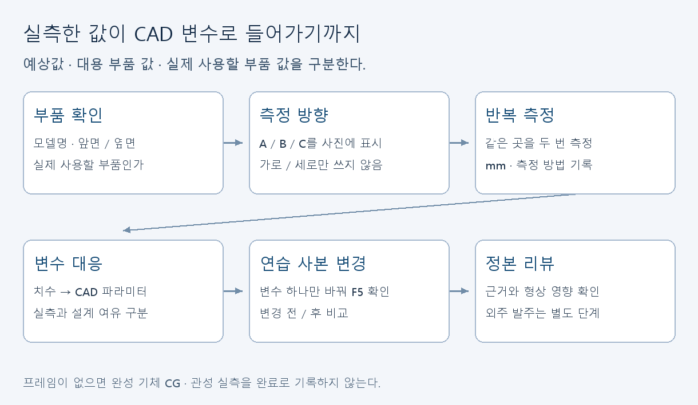

# 실측·CAD: 숫자가 실제 부품과 맞는지 확인하기

[학습 안내](../README.md) · [자료실 C01–C05](../resources.md#cad실측)

지훈의 측정값이 민찬의 CAD 변수로 들어간다. 프린트가 없어도 부품 자체와 장착 치수는 확인할 수 있다. 오늘은 서보 한 개의 치수 방향·단위·측정 근거를 남긴다.



## 첫 30분

1. [CAD 조립 렌더](../../../cad/renders/preview_colored.png)와 [베인링 확대](../../../cad/renders/vane_ring_closeup.png)를 열어 서보 위치를 찾는다.
2. 실제 사용할 서보 모델 표기와 앞·옆 모습을 기록한다. 측정 방향을 A/B/C로 표시한다. 부품의 “가로”라는 말만 쓰지 않는다.
3. 캘리퍼스 외측 측정면을 찾아 몸통의 긴변·짧은변·높이를 각각 두 번 잰다. mm 단위를 붙인다. 값이 다르면 측정 자세를 확인해 다시 잰다.
4. [실측 기록표](../../../cad/measurements.md) 형식에 맞춰 기록하고 민찬과 [CAD 정본](../../../cad/hopper_params.scad)의 변수에 대응시킨다.
5. 민찬은 OpenSCAD에서 정본을 열고 F5로 조립 미리보기를 보여준다. 변경은 연습용 사본에서 먼저 시연한다.

계측기가 없으면 측정값을 추정해서 채우지 않는다. 모델명·사진·미측정 항목과 필요한 도구를 정리하는 것이 그날 결과다. SG90 대용 측정값을 실제 MG90S의 확정 치수로 취급하지 않는다.

## CAD를 처음 쓰는 사람의 작은 연습

C03 영상을 보고 C02에서 cylinder, difference를 찾는다. 별도 연습 파일에 아래를 입력한다. 치수 단위는 mm로 해석하는 연습이다. 호퍼 출력 부품 도면이 아니다.

```scad
$fn = 64;
outer_d = 30;
inner_d = 20;
difference() {
    cylinder(h=6, d=outer_d);
    translate([0, 0, -1]) cylinder(h=8, d=inner_d);
}
```

F5로 확인한 뒤 `outer_d`만 34로 바꾼다. 외경은 바뀌고 내경은 유지되는지 설명한다. F6 렌더링은 형상을 계산하는 작업이며 강도·공차·조립 적합성을 검증한 것은 아니다. 우리 정본의 `render_mode="preview"`는 조립 미리보기이고 출력용 부품과 구분한다. [CAD 사용 안내](../../../cad/README.md)를 함께 본다.

## 다음 실습과 심화

측정은 몸통 다음으로 장착 귀 홀 피치, 홀 지름, 축 위치, 서보 혼과 베인 사이 연결 공간으로 확장한다. 사진에 측정점을 표시해 다른 사람이 같은 곳을 다시 잴 수 있게 한다. 완성 프레임이 없으므로 기체 전체 CG·관성을 실측했다고 쓰지 않는다.

C04는 다이얼 캘리퍼스 시연이다. 디지털 도구에서는 눈금 읽기 방식이 다르다. C05의 교정 개념을 보고 영점 확인·반복 측정·정식 교정을 구분한다. 표준기 없이 ‘교정 완료’로 적지 않는다. C01의 문서와 C02를 보며 module, translate, rotate로 부품의 상대 위치를 읽는다.

최종적으로 [기계통합 설계](../../design/01-avionics-integration-final.md)의 해당 장착 설명과 대조한다. 측정값과 설계 여유·공차는 다른 값이다. 차이가 있으면 왜 여유가 필요한지 기록하고 정본 반영은 리뷰한다. 이번 실습에 외주 발주나 프린트 조립 완료를 포함하지 않는다.

## 제출

부품 사진 또는 스케치, 측정 방향, 반복값과 단위, CAD 변수 대응 한 줄을 남긴다. 변경 전후 화면을 제출할 때 연습 사본인지 정본인지 표시한다. [결과 양식](../submission.md)을 쓴다.
