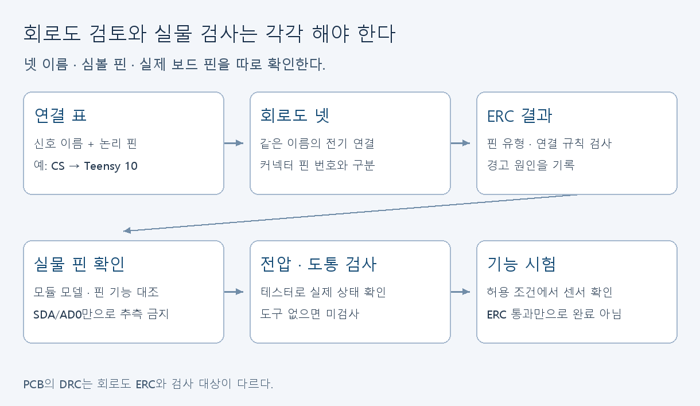
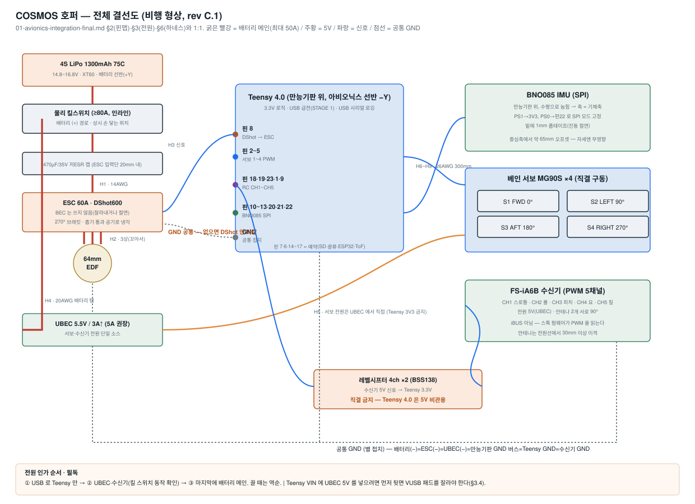

# KiCad: 배선의 연결 관계를 읽고 검토하기

[학습 안내](../README.md) · [자료실 K01–K10](../resources.md#kicad)

민우의 첫 과제는 기존 회로도에서 연결 하나를 추적하는 것이다. 현재 저장소는 아비오닉스 배선의 회로도 캡처 단계다. 맞춤 PCB가 제조·실물 검증됐다는 뜻은 아니다.

## 첫 30분

| 순서 | 자료·동작 | 정상 결과 |
|---|---|---|
| 1 | K02 영상의 프로젝트·편집기 소개, K01의 Schematic Editor | 회로도 편집기가 어느 창인지 찾음 |
| 2 | [프로젝트 파일](../../../kicad/cosmos-avionics/cosmos-avionics.kicad_pro)을 KiCad로 열기 | Schematic Editor에 회로 표시 |
| 3 | BNO085 쪽 CS 넷과 Teensy 쪽 같은 이름 찾기 | 두 지점을 화면에서 짚음 |
| 4 | [핀맵 §2.2](../../design/01-avionics-integration-final.md)와 대조 | CS의 Teensy 논리 핀 10 확인 |
| 5 | ERC 실행. 안 되면 실행 실패를 기록 | 오류·경고 목록 또는 실패 메시지 |

[KiCad README](../../../kicad/README.md)에 있는 범용 커넥터 심볼 설명을 먼저 읽는다. 심볼의 핀 번호를 Teensy 보드의 핀 번호로 동일시하지 않는다. 연결 추적 표는 `넷 이름 / Teensy 논리 핀 / 대상 신호 / 실물 확인 여부` 네 열로 만든다.

## 회로도를 한 번 직접 그려보기

K03 영상을 보고 별도 연습 프로젝트에 커넥터 심볼 두 개를 배치한다. 핀 하나를 wire로 연결하고 같은 넷 이름을 붙인다. 핀 위치가 그리드에서 벗어나 선이 실제로 안 붙는 경우가 있는지 확인한다. 이 연습 파일은 실물 배선 지시가 아니다.

K05로 넷 이름, No Connect, 전원 관련 ERC를 배운다. 실제로 안 쓰는 핀과 실수로 끊긴 선을 구분한다. 오류를 숨기거나 PWR_FLAG를 무조건 붙여 초록불을 만들지 않는다. 오류 하나를 골라 “어떤 핀 유형·전원 공급 가정 때문에 떴는지” 적는다. 기능·전압·핀맵을 확인하지 않고 ERC 통과만 보고 배선을 승인하지 않는다.

## 자료를 보는 순서

K02 → K03 → K05를 먼저 본다. K04는 우리 모듈용 심볼을 만들 필요가 생길 때 읽는다. 기존 범용 심볼에서 실제 핀의 의미를 정확히 추적하는 것이 먼저다. K09의 42:54–49:25는 ERC·annotation의 다른 사례다. KiCad 6 화면이라 현재 메뉴와 다를 수 있다.

K06의 풋프린트는 회로 심볼에 대응하는 실제 PCB 패드·홀 배치다. 심볼이 맞아도 풋프린트의 핀 순서·간격이 틀리면 부품이 맞지 않는다. PCB가 별도 과제로 승인되면 데이터시트·실측·풋프린트를 대조한 뒤 K07 배치·DRC, K08 Gerber·드릴·BOM으로 간다. 이 영상의 수분 경보기와 STM32/MSPM0 칩 회로를 우리 Teensy 회로로 복제하지 않는다.

## 실제 배선으로 넘어가기 전

아래 [기존 전원·신호 도면](../../design/system-wiring-final.svg)을 최신 핀맵·실물 부품과 함께 대조한다. 도면을 읽는 연습과 전원 투입 검사를 구분한다. 실제 센서 모듈의 핀 기능과 전압을 확인해야 한다. 테스터가 없으면 도통·레일전압 확인은 미검사로 남긴다.

## 제출

CS 추적 한 줄, ERC 결과, 확인하지 못한 실물 항목을 [결과 양식](../submission.md)에 적는다. 파일 열기 실패라면 버전·파일 경로·오류 화면을 남긴다. 보안 기능을 임의로 끄거나 모르는 경고를 일괄 무시하지 않는다.
