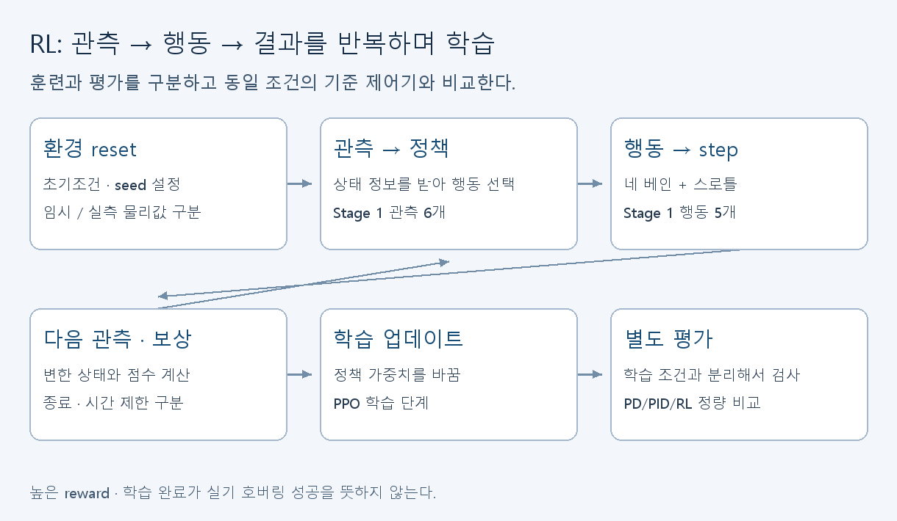

# 시뮬레이션·RL: 환경을 이해하고 비교를 재현하기

[학습 안내](../README.md) · [자료실 R01–R19](../resources.md#시뮬레이션rl) · [제어 입문](control.md)

Stage 1은 빠른 검증용 Python 환경이다. 최종 목표인 우리 기체의 3D 물리 환경과 RL 비교를 대신하지 않는다. 첫 과제는 긴 학습을 돌리는 것이 아니라 환경의 입력·출력과 한 스텝의 뜻을 설명하는 것이다.



## 첫 30분

R09 영상 14:05 또는 R01의 agent/environment 그림을 보고 관측·행동·보상을 설명한다. [Stage 1 환경](../../../sim/sim_stage1/hopper_aviary.py)에서 `reset`, `step`, `observation_space`, `action_space`를 찾는다. 준비된 환경이면 저장소 루트에서 아래를 실행한다.

```powershell
python tasks.py setup
python tasks.py sanity --force
```

Python·uv가 없으면 [저장소 설치 안내](../../../README.md#소프트웨어팀)를 먼저 따른다. 버전은 `uv.lock`으로 맞춘다. 공식 강의의 pip 설치 명령을 섞지 않는다. 첫 설치·다운로드 시간은 30분 활동에 포함되지 않을 수 있다.

정상 결과는 sanity 성공 로그와 상태·행동 설명이다. sanity는 환경을 짧게 실행하는 검사다. 학습한 제어기가 안정적이거나 실물에서 성공했다는 증거가 아니다.

## 코드에서 작성할 표

| 항목 | 현재 Stage 1에서 확인할 것 |
|---|---|
| 관측 6개 | 세 자세각과 세 각속도. 순서·단위를 코드에서 확인 |
| 행동 5개 | 네 베인과 스로틀. 정규화 범위와 물리 단위 변환 위치 |
| reset | 초기조건·seed·무작위 파라미터를 적용하는 곳 |
| step | 힘·토크·상태 갱신·reward·종료를 만드는 곳 |
| reward | 자세 오차와 제어 사용 등의 각 항이 장려하는 행동 |
| 종료 | 실패 조건과 시간 제한을 구분하는 곳 |

모르는 값은 추측하지 말고 코드 위치를 적는다. 상태를 주는 방법과 정책이 보는 관측은 실제 센서의 측정 가능 범위·지연까지 고려해야 한다. IMU·ToF·광류만으로 전체 위치·속도가 오프셋 없이 확보된다고 가정하지 않는다.

## 다음 자료와 실습

R10 → R02로 환경·보상을 연결한다. R03 → R04로 학습 `learn`과 행동 선택 `predict`를 구분한다. R11로 정책 가중치와 알고리즘을 읽는다. 기존 실행법은 [sim README](../../../sim/README.md)와 `tasks.py`를 따른다. 처음부터 학습 횟수·환경 구조·보상·물리값을 동시에 바꾸지 않는다.

R05를 읽고 평가 seed, 초기조건, 외란, 정책 버전, 물리값을 기록하는 표를 만든다. 여러 학습 실행과 별도 평가 조건을 구분한다. 한 번 높은 reward를 얻은 결과만 보고 RL이 baseline보다 좋다고 결론 내리지 않는다.

## 3D 환경 전환을 검토할 때

[제어 설계 §2](../../design/03-control-pipeline-design.md)와 [논문·코드 대응](../../design/modelling-notes-ch3.md)을 먼저 본다. PyBullet/PyFlyt 후보가 우리 단일 EDF+베인 4개를 어떤 힘·토크·액추에이터로 표현하는지 **코드 근거**로 검토한다. URDF 파일 교체만으로 물리가 맞는다고 판단하지 않는다. CAD 시각화, 질량·관성, 베인 공력, 서보 지연·제한, 추력 반응, 센서 관측, reset/step, 평가 재현 여부를 각각 확인한다.

도메인 무작위화 범위는 실측 오차·장치 특성에서 정한다. CoG ±10mm나 지연 20–40ms 같은 예시 숫자를 검증된 우리 장치 값으로 사용하지 않는다. MCU의 추론 시간도 실제 빌드·연산·루프 지연을 측정해야 한다. ONNX 파일이 생겼다고 Teensy 배포가 완료된 것은 아니다.

심화 순서는 R17 → R18 → R19 슬라이드, R06 → R07의 PPO 수식이다. R12–R15는 로봇·현실 적용 문제를 검토할 때 쓴다. David Silver의 긴 강좌 R16을 첫날 완강 숙제로 주지 않는다.

## 제출

sanity 로그, 상태·행동·reward 표, 실측/임시 파라미터 목록, 다음 평가 계획을 남긴다. 설치 실패와 코드 실패를 구분한다. 현재 `Kf`는 이미 잠정 스케일 보정됐지만 실측이 아니며 옛 37배 부족 진단을 현재 값에 그대로 적용하지 않는다. [결과 양식](../submission.md)을 따른다.
