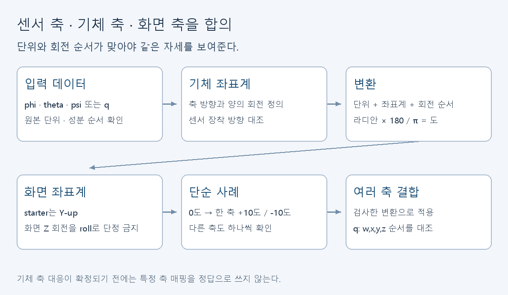

# 웹·3D·데이터: 숫자를 읽고 화면에 표현하기

[학습 안내](../README.md) · [자료실 W01–W08](../resources.md#웹3d데이터)

민지의 첫 목표는 기체 모형 하나를 띄우고 입력에 맞춰 움직이는 것이다. 최종 웹은 실험·시뮬레이션 로그를 그래프와 3D 자세로 보여준다. 물리 계산과 RL 학습은 별도 트랙이다.

## 첫 30분

W03의 scene, camera, renderer, mesh 설명을 읽는다. JavaScript가 처음이면 W01·W02를 부장·차장과 같이 읽고 변수와 함수 호출부터 확인한다. 이후 [동봉 웹 모형](../starter/README.md)을 실행한다.

```powershell
# 저장소 루트에서 시작할 때
cd docs/learning/starter
python -m http.server 8000 --bind 127.0.0.1
```

브라우저에서 <http://127.0.0.1:8000/>을 열고 슬라이더 → 초기화 → 합성 반복 회전 순서로 해본다. `index.html`의 팬 색 변수 하나를 바꿔 저장·새로고침한다. 정상 결과는 모형이 움직이고 색이 바뀌는 것이다. Console에 오류가 뜨면 먼저 그 메시지를 기록한다.

현재 모형은 실제 CAD가 아닌 연습 형상이다. 자동 회전도 합성이다. 아직 CSV·IMU·물리 엔진이 연결되지 않았다. 첫 실행에는 Three.js를 로컬에 동봉해 CDN·npm 설치가 필요 없다. 정식 앱의 빌드 구조·라이브러리 버전은 [웹 설계](../../design/02-web-dashboard-design.md)를 따른다.

## 다음: 한 줄 데이터와 단위

[합성 CSV](../starter/sample-synthetic.csv)를 표로 열어 `t_ms`, `source`, `phi`를 찾는다. `t_ms=500`의 phi는 약 10도다. CSV는 라디안이므로 `deg = rad * 180 / Math.PI`로 표시 단위를 바꾼다. 원본 단위와 화면 단위를 모두 표시한다. 실제 IMU 테스트 스케치의 도 단위 출력과 그대로 이어붙이지 않는다.

W08의 local file parsing, header, errors를 보고 파서 설계를 적는다. 빈 파일, 헤더 누락, 숫자 아닌 값, 시간 역전, 합성/실측 출처를 어떻게 보여줄지 정한다. 없는 필드를 0으로 채워 실제 측정처럼 만들지 않는다. W07로 시간–phi 선 그래프를 설계한다. 차트에 축 이름과 단위를 붙인다.

starter가 CSV를 읽는 기능을 이미 제공한다고 적지 않는다. CSV 파서와 차트는 다음 구현 과제다. 정식 계약은 [웹 설계 §4](../../design/02-web-dashboard-design.md)를 보고 재후와 필수·선택 필드를 합의한다. 동봉 CSV는 입문용 일부 필드이며 계약 변경안이 아니다.

## 회전축을 합의해야 하는 이유



starter는 Y-up 장면에서 화면 Z축으로 회전한다. 실제 기체의 roll이라고 이름만 바꾸면 안 된다. 기체 좌표계의 축 방향, 화면 좌표계, 각 단위, Euler 회전 순서를 정해 변환한다. 쿼터니언으로 넘어가면 센서/로그의 `w,x,y,z`와 라이브러리 함수의 인자 순서를 대조한다. 0도 → 한 축 +10도 → 한 축 -10도 → 다른 축의 단순 사례로 검증한 후 여러 축을 결합한다.

W04로 창 크기에 따른 화면 비율을 확인한다. W06의 첫 Getting Started 프로젝트로 코드 구조를 비교한다. W05 JavaScript 강좌는 모르는 변수·함수·배열 부분만 먼저 찾아본다. 긴 강좌 완강을 화면 첫 동작의 선행조건으로 만들지 않는다.

## 완료 기준

첫 실습은 자기 PC 화면, 수정한 색 변수, scene/camera/mesh/render 위치 설명으로 확인한다. 다음 단계는 CSV 한 행을 해석하고 차트·회전 변환의 단위를 설명하는 것이다. 최종 대시보드 완료와 구분한다. [결과 양식](../submission.md)에 합성/실측과 미구현 기능을 적는다.
