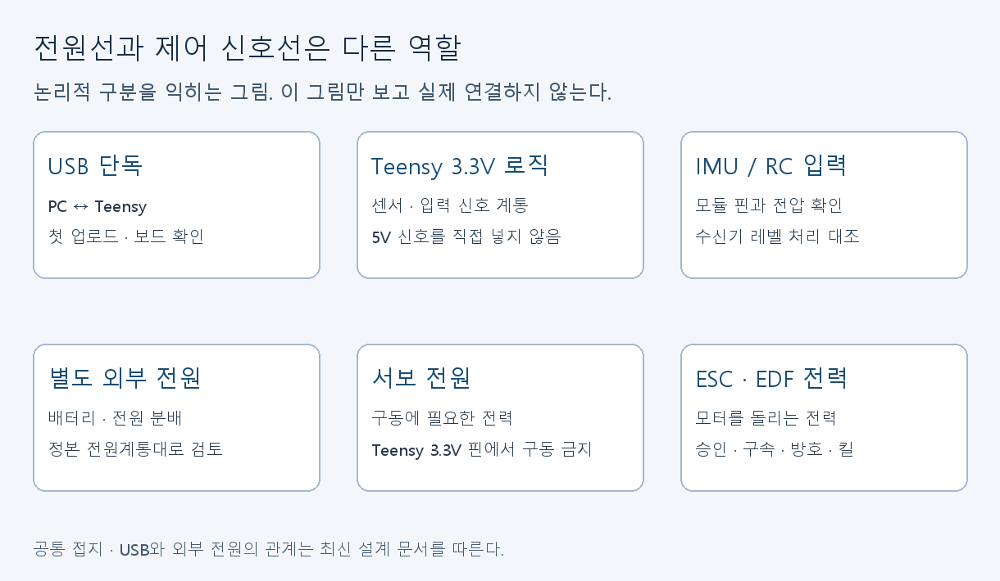
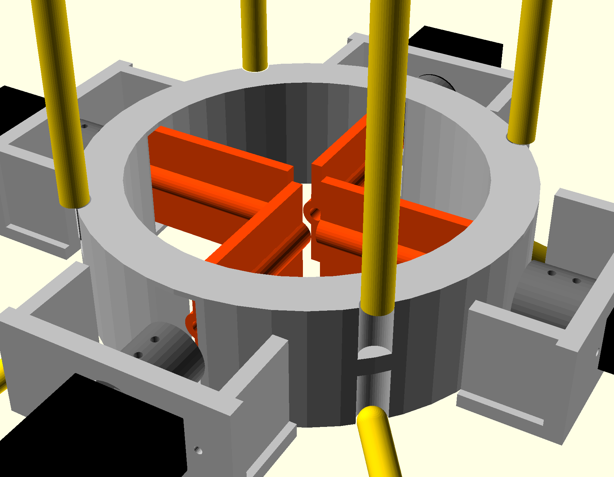

# 그림으로 보는 작업 흐름과 실제 프로젝트 도면

[학습 안내](README.md) · [한국어 설명](concepts.md)

아래 9개 개념도는 이 학습 자료를 위해 작성했다. 연결 관계를 설명하는 그림이며 제작 치수·실물 배선 지시가 아니다. 실제 프로젝트 도면과 CAD 렌더는 뒤에 별도로 연결했다.

## 각 담당의 위치

자기 작업을 찾고 다음 담당에게 무엇을 전달할지 말한다. 실측표, 배선 확인표, 센서 로그, 상태·행동 정의, CSV 계약처럼 넘겨줄 결과의 이름을 붙인다.

## 피드백과 로그

목표에서 제어 요구가 나오고 기체 상태가 센서를 거쳐 다시 제어기에 들어온다. 로그와 웹은 이 정보를 읽는 별도 경로다. 모형 회전 화면을 만들었다고 제어기가 검증된 것은 아니다.

## Build·Upload·센서 수신

어느 단계가 성공했고 어디에서 실패했는지 표시한다. 외부 장치 연결 없이도 가능한 Build부터 확인한다.

## 전원과 신호

실물 배선은 아래 최신 아비오닉스 문서와 모듈 데이터시트를 대조한다. USB·외부 전원·서보 전원을 이 그림만 보고 결선하지 않는다.

## KiCad와 실제 검사

CS 넷 하나를 따라가고 ERC 결과, 실제 핀, 전압 확인을 서로 다른 결과로 기록한다.

## 실측과 CAD

측정 방향과 반복값을 남긴 뒤 변수 하나를 연습 사본에서 바꿔본다. 부품 모델이나 측정 근거가 없으면 확정값으로 올리지 않는다.

## 좌표계와 단위

특정 기체축과 화면축 대응을 아직 확정한 그림이 아니다. 입력과 출력의 축·단위·회전 순서를 합의할 때 사용하는 점검 흐름이다.

## CAD·물리 환경·웹 데이터

기체 형상, 힘·토크 계산, 학습, 실물 계측, 로그 화면의 역할을 구분한다.

## RL 학습과 평가

한 스텝과 정책 업데이트를 구분하고 별도 평가에서 baseline과 비교한다.

## 기존 설계의 실제 그림

| 자료 | 보는 목적 | 함께 볼 정본 |
|---|---|---|
| [조립 CAD 렌더](../../cad/renders/preview_colored.png) | 팬·프레임·장비 선반 위치 | [CAD](../../cad/hopper_params.scad) |
| [베인링 확대](../../cad/renders/vane_ring_closeup.png) | 네 베인과 서보 배치 | [기계 통합](../design/01-avionics-integration-final.md) |
| [전체 배치도](../design/general-arrangement.svg) | 기체 공간 구성 | [마스터 설계](../design/00-hopper-master-design.md) |
| [기계 통합도](../design/mechanical-integration.svg) | 탑재 부품의 상대 위치 | [아비오닉스·기계 통합](../design/01-avionics-integration-final.md) |
| [전원·신호 계통도](../design/system-wiring-final.svg) | 전원 경로와 신호 연결 | 위 문서 §2 핀맵·전원계통 |
| [브레드보드 배치도](../design/avionics-breadboard.svg) | 기존 벤치 배치 구조 읽기 | 위 문서 §4. 실물 핀 대조 별도 |
| [만능기판 배치도](../design/avionics-perfboard.svg) | 부품·홀 배치 계획 읽기 | 위 문서 §5. 실제 납땜·도통 검사 별도 |

외부의 도면·사진·슬라이드는 [자료실](resources.md)에 저자 원문 링크로 제공한다. 개념도 생성 코드는 [build_visuals.py](build_visuals.py)다. 재생성에는 Pillow와 한국어 글꼴이 필요하며 학생의 첫 실습에는 설치할 필요가 없다. 기본 글꼴 경로는 Windows 맑은 고딕이다. 다른 환경에서는 `--font`로 글꼴을 지정한다.
